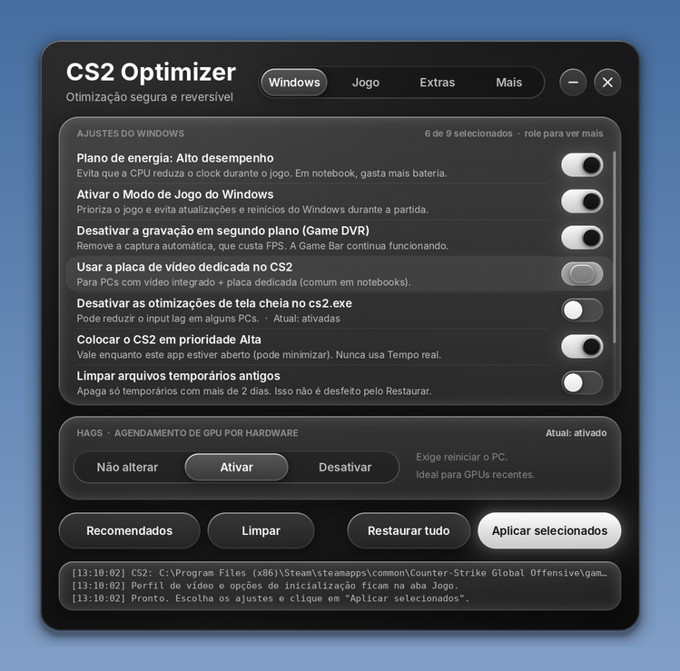
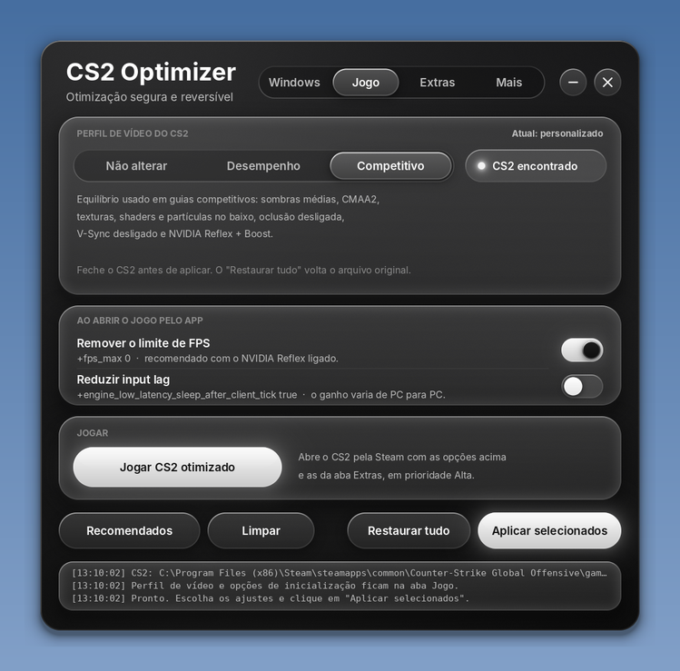
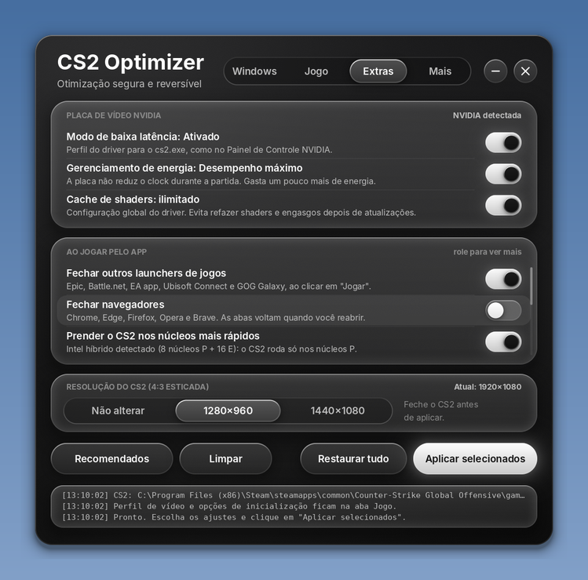
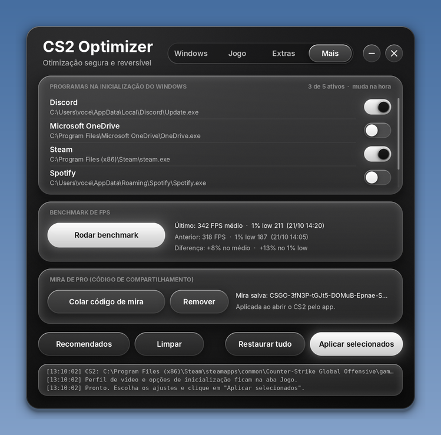

# CS2 Optimizer

Otimizador **seguro e reversível** do Windows para **Counter-Strike 2**.
Um único `.exe` portátil, sem instalação, com interface própria em estilo *liquid glass*.

- **Nada é alterado sem você escolher.** Cada ajuste é uma chave que você liga.
- **Tudo pode ser desfeito.** Antes de mudar qualquer coisa, o app guarda o valor original, e o botão **Restaurar tudo** volta como estava.
- **Sem "tweaks" perigosos.** Não desliga Windows Defender, Integridade de Memória, proteções contra Spectre/Meltdown, nem dezenas de serviços do Windows.

<p align="center">
  
  
  
  
</p>

## Download

Baixe o `CS2 Optimizer.exe` na página de [Releases](../../releases) e abra. O app pede permissão de administrador, porque mexe em configurações do sistema.

> **Aviso do Windows ("O Windows protegeu o computador")**: o executável ainda não tem assinatura digital. Clique em **Mais informações → Executar assim mesmo**, ou clique com o botão direito no arquivo → **Propriedades** → marque **Desbloquear**. O código está todo aqui para quem quiser conferir ou compilar.

## O que ele faz

### Windows
| Ajuste | O que muda |
|---|---|
| Plano de energia Alto desempenho | A CPU não reduz o clock durante o jogo |
| Modo de Jogo do Windows | Prioriza o jogo e segura o Windows Update durante a partida |
| Desligar Game DVR | Remove a gravação automática em segundo plano |
| GPU dedicada no CS2 | Útil em notebooks com vídeo integrado + dedicado |
| Desligar otimizações de tela cheia | Pode reduzir input lag em alguns PCs |
| CS2 em prioridade Alta | Enquanto o app estiver aberto (nunca "Tempo real") |
| Suspensão seletiva de USB / economia do PCIe | Evita microtravadas por economia de energia |
| Agendador multimídia (MMCSS) | Prioridade para jogos |
| Timer de 0,5 ms (Windows 11) | Frames mais regulares, principalmente com FPS limitado |
| Transparência, aceleração do mouse | Ajustes leves de sistema |
| Limpezas | Arquivos temporários antigos e cache de shaders |
| HAGS | Ativar, desativar ou não mexer, com o estado atual visível |

### Jogo
- **Perfis de vídeo** *Desempenho* e *Competitivo*: altera só as chaves conhecidas do `cs2_video.txt` de cada conta Steam (com cópia de segurança).
- **Jogar CS2 otimizado**: abre o jogo pela Steam com `+fps_max 0` e outras opções, sem mexer nas suas opções de inicialização.

### Extras
- **NVIDIA**: modo de baixa latência, desempenho máximo e cache de shaders ilimitado, aplicados no perfil do driver (como no Painel de Controle NVIDIA).
- **Ao jogar pelo app**:
  - fechar launchers e navegadores;
  - prender o CS2 nos núcleos mais rápidos (núcleos P nos Intel de 12ª a 14ª geração, CCD com 3D V-Cache nos Ryzen X3D de 2 CCDs);
  - mover apps de fundo para os núcleos E;
  - vibrância digital (NVIDIA) só com o jogo em primeiro plano;
  - limpeza da memória em espera, como o ISLC.
- **Resolução 4:3 esticada** (1280×960 ou 1440×1080).
- **Aviso de microcódigo** para Intel de 13ª e 14ª geração de desktop com BIOS desatualizada (instabilidade *Vmin Shift*; correção 0x12F).

### Mais
- **Programas na inicialização**: liga e desliga como o Gerenciador de Tarefas.
- **Benchmark de FPS**: FPS médio e 1% low no mapa *CS2 FPS Benchmark* da Oficina (ID `3240880604`), com comparação entre medições.
- **Mira de pro**: cole um código de mira (formato antigo `CSGO-…` ou o novo `CS…`). Ele é aplicado com `apply_crosshair_code` ao abrir o jogo pelo app.

## Onde ficam os dados

Tudo fica em `%APPDATA%\CS2Optimizer`:
- `restore-data.json`: valores originais usados pelo **Restaurar tudo**;
- `video-backup\`: cópias do `cs2_video.txt`;
- `settings.json`: suas preferências;
- `benchmarks.json`: histórico de medições.

## Compilar

Precisa de [Go 1.24+](https://go.dev/dl/) e Python 3 com Pillow (para gerar ícone, manifesto e versão).

```bash
pip install pillow
python tools/mkres.py rsrc_windows_amd64.syso
GOOS=windows GOARCH=amd64 CGO_ENABLED=0 go build -trimpath -ldflags "-H windowsgui -s -w" -o "CS2 Optimizer.exe" .
```

No Windows (PowerShell), troque a última linha por:

```powershell
$env:GOOS="windows"; $env:GOARCH="amd64"; $env:CGO_ENABLED="0"
go build -trimpath -ldflags "-H windowsgui -s -w" -o "CS2 Optimizer.exe" .
```

Os testes (`go test ./...`) rodam em qualquer sistema e também geram prévias da interface (`preview.png`).

### Publicar uma versão

Na página do repositório, vá em **Releases → Draft a new release**, crie uma tag (por exemplo, `v2.0.1`) e clique em **Publish release**. O GitHub Actions compila e anexa o `CS2 Optimizer.exe` ao Release automaticamente em alguns minutos (empurrar uma tag pelo git também funciona).

## Estrutura

| Arquivo | Conteúdo |
|---|---|
| `main_windows.go` | Janela, eventos e ações |
| `scene.go`, `render.go` | Layout e renderizador próprio (independentes do Windows, testáveis) |
| `tweaks_windows.go`, `system_windows.go` | Ajustes do Windows, backup e restauração |
| `game_windows.go`, `video.go` | Perfis de vídeo, resolução e abertura do jogo |
| `nvidia_windows.go` | Perfil do driver NVIDIA via NVAPI DRS |
| `cpu_windows.go`, `topology.go`, `extras_windows.go` | Núcleos P/E, X3D e microcódigo |
| `startup_windows.go`, `bench_windows.go`, `crosshair.go` | Aba Mais |

## Créditos

- IDs e estruturas da NVAPI conferidos em [NVIDIA/nvapi](https://github.com/NVIDIA/nvapi); IDs de vibrância em [arcnmx/nvapi-rs](https://github.com/arcnmx/nvapi-rs).
- Formatos de código de mira documentados em [akiver/csgo-sharecode](https://github.com/akiver/csgo-sharecode).
- Mapa de benchmark: *CS2 FPS Benchmark*, na Oficina Steam.

## Aviso

Projeto independente, sem relação com a Valve, a NVIDIA, a AMD ou a Intel. Counter-Strike é marca da Valve Corporation. Use por sua conta e risco; o app foi feito para ser conservador e reversível, mas cada PC é diferente.

## Licença

[MIT](LICENSE)
